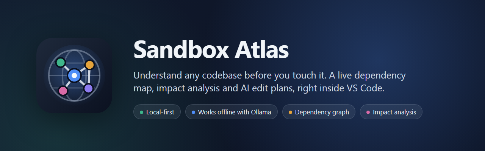
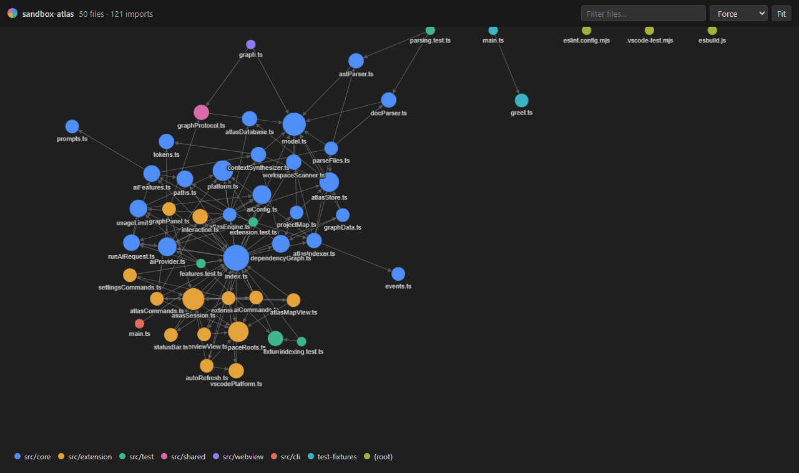
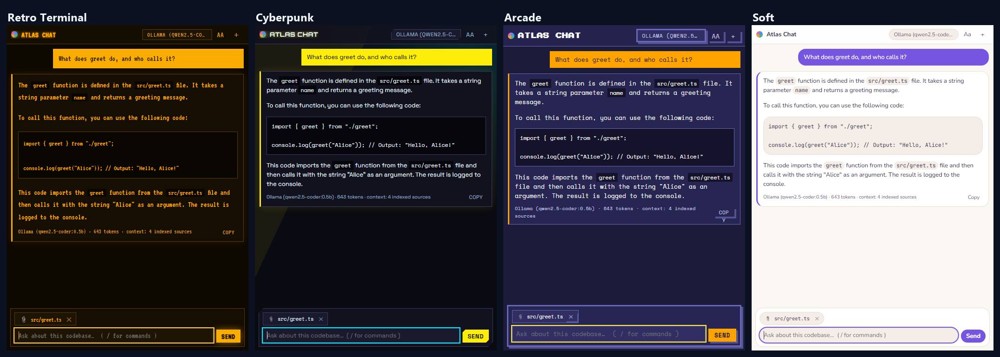
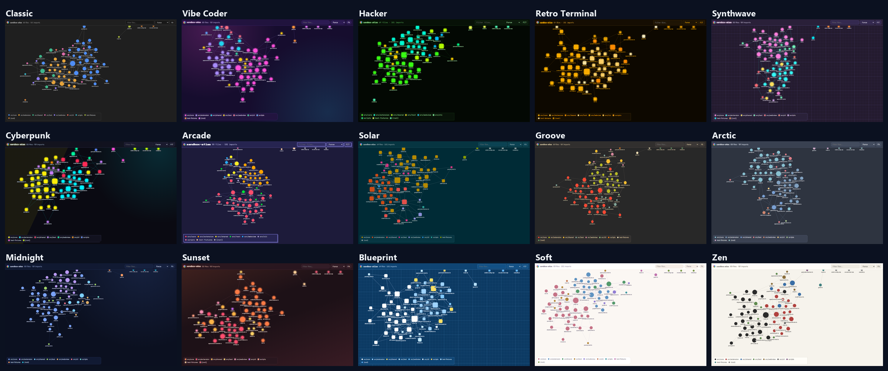
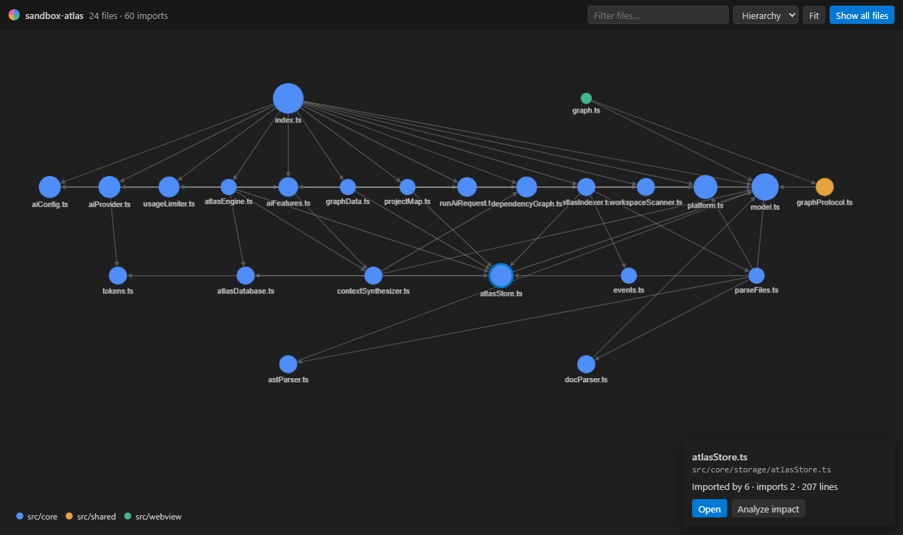
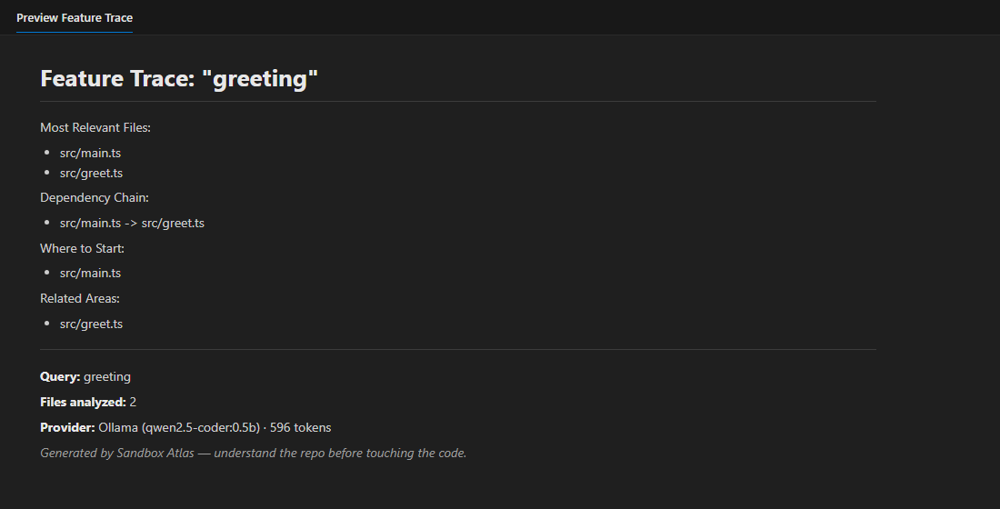
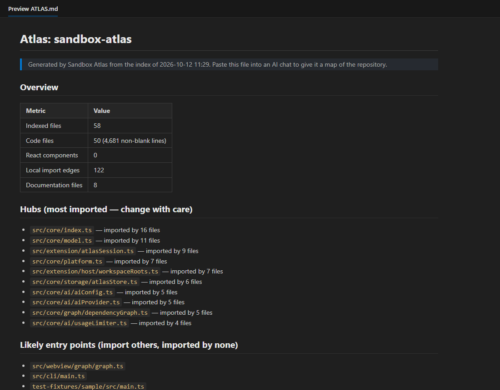

<p align="center">
  
</p>

<p align="center">
  <a href="https://github.com/Nexkeys/sandbox-atlas/actions/workflows/ci.yml"></a>
  
  
  <a href="LICENSE"></a>
</p>

**Sandbox Atlas** maps your codebase locally (files, components, functions and the real import
graph) and answers the questions you'd otherwise ask a senior teammate:

- *Where does this feature live?*
- *What breaks if I change this file?*
- *What's the safest way to make this edit?*

It works fully offline with Ollama or LM Studio, or with your own Gemini, OpenAI or OpenRouter key.
Your code stays on your machine unless you choose an online provider.

<p align="center">
  
  <br><sub>Sandbox Atlas mapping its own codebase. Colours are folders, size is how many files import it.</sub>
</p>

## Why Sandbox Atlas

| | |
| --- | --- |
| **Zero setup** | Install and it indexes. No Python, no server, no native binaries, no account. |
| **A real dependency graph** | Resolves relative imports, barrels (`index.ts`), `@/` and `~/` aliases, `.js`→`.ts` ESM imports, `require()` and dynamic `import()`. |
| **Impact you can trust** | Impact Analysis is built on the resolved graph (direct and second-level dependents), not on the model's guess. |
| **Built for AI editors** | Export an `ATLAS.md` map, or paste an Edit Plan into Cursor, Copilot or Claude. |
| **Private by default** | Indexing, the map and the graph never use AI. Offline mode never touches the network. |
| **Cost-safe** | Daily request cap for paid providers. Keys live in encrypted Secret Storage. |

## 💬 Chat with your codebase

Open **Chat** at the top of the Sandbox Atlas sidebar (<kbd>Ctrl</kbd>+<kbd>Alt</kbd>+<kbd>A</kbd>) and ask anything in plain English:
*"Where is authentication handled?"*, *"What breaks if I change this file?"*,
*"How do I add a new API route?"*

- **Answers stream in** and use your local Atlas index as context: files, exports, components and
  the real import graph. Stop an answer at any time.
- **The open file is attached automatically** (📎), so questions like *"what does this do?"* focus
  on it and the files that import it. Right-click any file and choose **Ask Atlas About This File**.
- **Type `/` for commands,** with autocomplete:

| Command | What it does |
| --- | --- |
| `/trace <feature>` | Where a feature lives and where to start reading |
| `/impact [file]` | What breaks if a file changes |
| `/plan <change>` | Step-by-step edit plan for the attached file |
| `/docs` | Summary of the project documentation |
| `/map` | Project map: hubs, entry points, folders (no AI) |
| `/graph [file]` · `/scan` · `/mode` · `/setup` · `/clear` · `/help` | Graph, re-index, appearance, AI setup… |

The conversation is kept per workspace. Prefer the terminal? `atlas chat` gives you the same chat,
streaming in your shell.



## 🎨 Make it yours: 15 modes

Run **Sandbox Atlas: Customize Appearance** and arrow through the list. Open Atlas panels
**preview each choice live**.

A mode is a whole personality, not just a palette. Each one sets:
- **colours** and visual effects
- **fonts**, bundled with the extension, so there's nothing to install
- an **icon set** for the sidebar and status bar, and the **graph node shapes**
- the **shape** of panels and buttons
- the **heading style**

| Mode | Personality | Fonts | Shapes and icons |
| --- | --- | --- | --- |
| **Classic** | Native; follows your VS Code theme | Your VS Code fonts | Rounded · classic symbols |
| **Vibe Coder** | Neon pink and violet gradients, glow | Inter + Poppins | Pill buttons · sparkles and stars |
| **Hacker** | Terminal green on black, CRT scanlines | JetBrains Mono | Sharp, UPPERCASE · terminal prompts |
| **Retro Terminal** | Amber phosphor CRT monitor | VT323 (pixel terminal) | Sharp, UPPERCASE · terminal |
| **Synthwave** | '80s neon over a purple night | Orbitron + Space Grotesk | Neon grid · stars |
| **Cyberpunk** | Night-city yellow and cyan | Orbitron + Space Mono | Cut-corner panels · schematics |
| **Arcade** | 8-bit console palette | Press Start 2P + Space Mono | Pixel borders · 8-bit icons |
| **Solar** | Solarized-style teal and gold | IBM Plex Sans + Plex Mono | Technical |
| **Groove** | Gruvbox-style warm retro | Fira Sans + Fira Code | Geometric |
| **Arctic** | Nord-style cool frost | Inter + JetBrains Mono | Minimal dots |
| **Midnight** | Deep navy, moonlit blues | Inter | Classic |
| **Sunset** | Warm oranges and rose | Space Grotesk + Poppins | Playful |
| **Blueprint** | White ink on a blue engineering grid | IBM Plex | Sharp · technical |
| **Soft** | Calm pastels on cream | Nunito | Rounded · minimal |
| **Zen** | Ink on paper, serif headings | Inter + Source Serif 4 | Minimal |



**Mix and match:** override the **interface font**, **code font** (14 bundled fonts, or your VS Code
fonts) and **icon set** (Classic, Terminal, Minimal, Playful, Technical, Geometric, Pixel) on top of
any mode.

**Matching editor themes (opt-in):** every mode except Classic ships a matching VS Code colour
theme, 14 in all. Sandbox Atlas asks before switching, and choosing **Classic** restores your
previous theme.

Built to be comfortable, not just pretty:
- Every palette is unit-tested against **WCAG AA contrast**.
- Glow and scanlines turn off for **reduced motion** and on very large graphs.
- **High-contrast** themes always use Classic.

## Features

### 🗺️ Atlas Map and Overview
A sidebar tree of every indexed file using your icon theme. Each file shows `←imported-by →imports`
counts. Expand a file to see its React components, hooks and functions, and click to jump to the
line. The **Overview** panel shows index health, the active AI provider, today's usage and quick
actions.

### 🕸️ Interactive dependency graph
**Sandbox Atlas: Show Dependency Graph** opens a themed, zoomable graph with force, hierarchy and
ring layouts, a live filter and a details card.

- Hover a file to light up its neighbours.
- Click **Focus** to see a file's neighbourhood.
- Run **Analyze impact** straight from a node.



### 🎯 Analyze Impact
Right-click any file, then **Sandbox Atlas → Analyze Impact**. You get a risk-rated breakdown of
the files that import it, the cascade beyond them, the exports that are dangerous to change, and
a verification checklist.

### 📝 Generate Edit Plan
Describe a change ("add input validation to the login form") and get an ordered, file-by-file
plan: what to read first, what to change, what to re-check, and the risks. It's a plan, not code,
so you stay in control. You can also paste it into your AI editor.

### 🔎 Trace Feature and 📚 Summarize Docs
Ask where "authentication" or "cart state" lives, or get a structured summary of your docs:
overview, setup, architecture and entry points.

Answers open in the themed **Atlas Results** panel, with Copy, Open as Markdown and Save. They
can also go to VS Code's markdown preview (`sandboxAtlas.results.view`).



### 🧭 Project map and `ATLAS.md`
An AI-free overview of the project:
- stats
- **hubs** (the most imported files, where changes have the widest blast radius)
- likely entry points
- docs
- a per-folder listing of components and exports

Export it as `ATLAS.md` to give any AI chat a map of your repo.



### ⚡ Always current
Saved, created and deleted files are re-indexed automatically; only changed files are re-parsed. Indexing
honours `.gitignore` (root and nested) and skips `node_modules`, build output, minified and very
large files. Multi-root workspaces are supported.

## Getting started

1. **Install** Sandbox Atlas from the VS Code Marketplace or Open VSX (for Cursor, Windsurf and
   VSCodium), or from a `.vsix` via *Extensions → … → Install from VSIX*.
2. **Pick a provider**: open the walkthrough with **Sandbox Atlas: Get Started**, or run
   **Sandbox Atlas: Select AI Provider**.
   - Offline (default): install [Ollama](https://ollama.com) and run `ollama pull qwen2.5-coder:3b`.
   - Online: choose Gemini, OpenAI or OpenRouter and paste your key when asked.
3. **Open the Sandbox Atlas sidebar** (the globe icon). Your workspace is already indexed.

## Commands

| Command | What it does |
| --- | --- |
| Show Dependency Graph | Interactive graph of the workspace (or of the active file with *…for File*) |
| Analyze Impact | What breaks if the active or selected file changes |
| Generate Edit Plan | Step-by-step plan for a described change |
| Trace Feature | Where a feature lives and where to start reading |
| Summarize Docs | Structured summary of README and docs |
| Generate Project Map / Export Atlas Notes | Markdown map of the repo, previewed or saved as `ATLAS.md` |
| Scan Workspace / Refresh Atlas | Index now (indexing is incremental) |
| Select AI Provider / Set AI API Key / Test AI Connection | Configure AI |
| Toggle Ignored Files (This Session) | Temporarily include `.gitignore`d files |
| Open Chat / Ask Atlas About This File | Chat with your codebase (<kbd>Ctrl</kbd>+<kbd>Alt</kbd>+<kbd>A</kbd>) |
| Customize Appearance / Select Mode / Toggle Visual Effects | Mode, fonts, icon set and effects, previewed live |
| Set Up AI | Check the AI provider and fix what's missing (no model, no key, model not downloaded) |

All commands are in the Command Palette under **Sandbox Atlas**. File commands are also in the
Explorer and editor context menus.

## No local model? It still works

- **Without any AI:** indexing, the Atlas Map, the dependency graph, impact counts, the project
  map and `ATLAS.md`, and all 15 modes need no model.
- **For AI answers:** Trace Feature, Summarize Docs, Analyze Impact and Edit Plans need a model.
  The first time you run one without a model, Sandbox Atlas walks you through it:

| Situation | What Sandbox Atlas offers |
| --- | --- |
| Nothing installed | **Set Up Ollama** (opens the download, then pulls the model in a terminal) or **Use Gemini (free key)** |
| Ollama running, model missing | **Download** the model, or **use a model you already have** |
| Online provider, no key | **Enter API key**, or switch to a local model |
| Key rejected | Enter a new key, or choose another provider |

After the fix, your command continues. Run **Sandbox Atlas: Set Up AI** at any time to check.
Sandbox Atlas never ships an API key: each user brings their own, so nobody pays for anyone else.

## AI providers

| Mode | Default model | Key | Data leaves your machine |
| --- | --- | --- | --- |
| `offline-ollama` (default) | `qwen2.5-coder:3b` | — | No |
| `offline-lmstudio` | `qwen2.5-coder:3b` | — | No |
| `online-gemini` | `gemini-2.5-flash` | Required | Yes, to Google |
| `online-openai` | `gpt-4o-mini` | Required | Yes, to OpenAI |
| `online-openrouter` | `mistralai/mistral-7b-instruct` | Required | Yes, to OpenRouter |

Prompts are sized to fit each provider: about 2,400 tokens of context for local models (inside
Ollama's default 4K window) and 8,000 for hosted models.

## Settings

| Setting | Default | |
| --- | --- | --- |
| `sandboxAtlas.ai.mode` | `offline-ollama` | AI provider |
| `sandboxAtlas.ai.offlineModel` / `onlineModel` | *(provider default)* | Model override |
| `sandboxAtlas.ai.baseUrl` | *(provider default)* | Custom OpenAI-compatible endpoint |
| `sandboxAtlas.ai.requestTimeoutSeconds` | `0` (auto: 300 s local, 120 s online) | Request timeout |
| `sandboxAtlas.ai.dailyRequestLimit` | `100` | Daily cap for online providers (`0` = unlimited) |
| `sandboxAtlas.index.autoRefresh` | `true` | Re-index on file changes |
| `sandboxAtlas.appearance.mode` | `classic` | One of the 15 modes |
| `sandboxAtlas.appearance.uiFont` / `codeFont` | `mode` | Font overrides (bundled fonts, or `editor` for your VS Code fonts) |
| `sandboxAtlas.appearance.iconSet` | `mode` | Icon set override |
| `sandboxAtlas.appearance.effects` | `true` | Glow and scanlines (always off for reduced motion) |
| `sandboxAtlas.appearance.applyColorTheme` | `ask` | Also switch VS Code to the matching colour theme: `ask`, `always` or `never` |
| `sandboxAtlas.results.view` | `panel` | Open results in the themed panel or the plain markdown preview |

## Privacy and security

- **No telemetry.** Sandbox Atlas collects nothing.
- The index is stored locally in VS Code's extension storage.
- **Offline modes never use the network.** Online modes send only the context shown in each
  request to the provider you chose.
- API keys are stored in VS Code **Secret Storage** (OS-encrypted), never in settings files.
- **Untrusted workspaces:** a cloned repo cannot redirect requests or influence commands through
  its own `.vscode/settings.json`, because workspace-level AI endpoint, provider and model
  settings are ignored. Model names are also validated before they ever reach a terminal.
- Webviews run under a strict Content Security Policy. AI output is rendered with raw HTML
  escaped and only http(s) links allowed, and link clicks are re-validated by the extension.
- Mode effects stay inside Sandbox Atlas's own panels. It never patches VS Code's files, unlike
  "glow" themes that make VS Code report a corrupt installation.

## Command line

The same engine runs without VS Code:

```bash
npm run build
node dist/cli.js chat                                   # interactive chat, streaming
node dist/cli.js map --out ATLAS.md                      # project map
node dist/cli.js impact src/api/client.ts               # AI impact analysis
ATLAS_API_KEY=… node dist/cli.js trace "auth" --mode online-gemini
node dist/cli.js --help
```

## Requirements

- VS Code **1.101+**, or Cursor, Windsurf or VSCodium on a matching base. The extension uses the
  built-in `node:sqlite` (Node 22.5+).
- For offline AI: Ollama or LM Studio. On CPU-only machines expect replies in 1–3 minutes;
  `qwen2.5-coder:1.5b` is faster.
- Languages: TypeScript, JavaScript (including JSX/TSX) and Markdown.

## Roadmap

- More languages (Python, Go), starting with import graphs.
- Folder-level graph clustering for very large monorepos.
- tsconfig `paths` alias resolution beyond `@/` and `~/`.
- A standalone desktop app on the same engine (see [Architecture](docs/ARCHITECTURE.md#building-a-desktop-exe)).

## Contributing

See [CONTRIBUTING.md](CONTRIBUTING.md) and [docs/ARCHITECTURE.md](docs/ARCHITECTURE.md).

## License

[MIT](LICENSE) © Nexkeys
