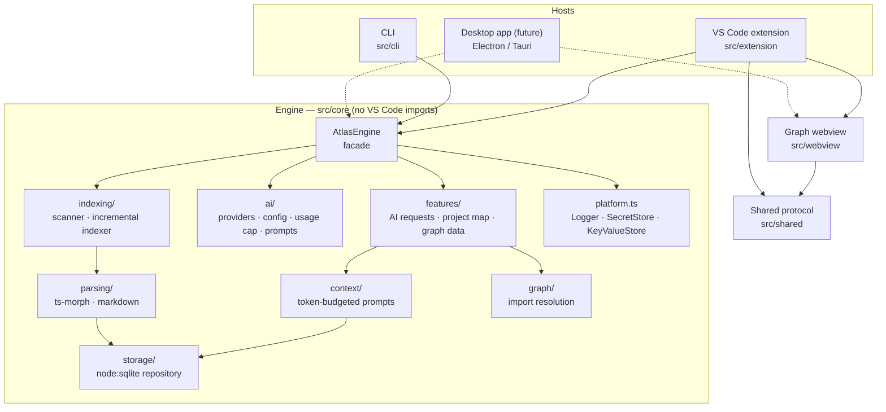

# Architecture

Sandbox Atlas is built as a **host-agnostic engine** with thin hosts around it. The VS Code
extension is one host, the CLI is another, and a desktop app can become a third without
rewriting the engine.



## Layers and rules

| Folder | Responsibility | May import |
| --- | --- | --- |
| `src/core` | Indexing, parsing, storage, graph, context, AI, features. Pure Node. | Node built-ins, npm libraries |
| `src/shared` | Appearance modes and webview message types shared by hosts, webviews and build scripts | `src/core/model.ts` types only |
| `src/webview` | Browser UI (graph). Bundled separately for the browser. | `src/shared`, core **types** |
| `src/extension` | VS Code UI: commands, views, status bar, webview hosting | everything above + `vscode` |
| `src/cli` | Command-line host | `src/core` |

The boundaries are enforced by ESLint (`no-restricted-imports` in `eslint.config.mjs`): importing
`vscode` anywhere outside `src/extension` fails the lint.

### Ports

The engine talks to its host only through three interfaces in `src/core/platform.ts`:

| Port | VS Code | CLI | Desktop (planned) |
| --- | --- | --- | --- |
| `Logger` | `LogOutputChannel` | stderr | file / devtools console |
| `SecretStore` | `SecretStorage` (encrypted) | environment variables | OS keychain (`keytar` / Electron `safeStorage`) |
| `KeyValueStore` | `globalState` | `~/.sandbox-atlas/state.json` | app data JSON |

AI settings arrive as a plain `AiSettings` object, so each host reads them from wherever it
likes: VS Code settings, CLI flags or env vars, a desktop settings screen.

## Data flow

1. **Scan.** `workspaceScanner` walks the folder in pure Node. It honours root and nested
   `.gitignore` files, always skips heavy folders (`node_modules`, `dist`, …), and skips files
   over 1 MB and `*.min.js`.
2. **Index.** `AtlasIndexer` re-parses only files whose mtime is newer than their cached parse,
   purges deleted files, and merges concurrent requests for the same root into one run.
3. **Parse.** `ts-morph` extracts imports, re-exports, `require`, dynamic `import()`,
   components, hooks and functions. It runs syntax-only, without the type checker. Markdown
   goes through `marked`. Results are written in chunks of 50 per transaction, yielding to the
   event loop between chunks.
4. **Graph.** `DependencyGraph` resolves specifiers to workspace files: relative paths, barrels,
   `@/` and `~/` aliases, and `.js` imports that point at `.ts` sources.
5. **Context.** `ContextSynthesizer` ranks code and docs against the request. For file-centred
   requests it pins the target and its resolved dependents. It then trims the result to the
   provider's token budget (2,400 tokens for local models, which fits Ollama's 4K window;
   8,000 for online models).
6. **AI.** `runAiRequest` applies the daily cap for online providers and calls any
   OpenAI-compatible endpoint with timeout and cancellation. It records usage and renders
   markdown.

## Appearance modes

`src/shared/appearance.ts` is the single source of truth for every mode: its palette, fonts,
radius, effects, status-bar icon and syntax colours. Three things read it:

- **Webviews** (`src/webview/common/appearance.ts`) turn a mode into `--atlas-*` CSS tokens and
  `data-glow`, `data-scanlines` and `data-grid` attributes. Classic maps the tokens onto VS Code's
  `--vscode-*` variables. High-contrast themes always fall back to Classic, and reduced motion
  disables effects.
- **The extension** (`src/extension/appearanceController.ts`) owns the setting and the live
  preview in the picker. It also handles the opt-in colour-theme switch, remembering the previous
  theme so Classic can restore it.
- **`npm run themes`** (`scripts/generate-themes.ts`) generates the seven matching colour themes in
  `themes/`. Run it after editing a palette and commit the output.

`src/test/unit/appearance.test.ts` fails the build if any palette drops below WCAG AA contrast.

## Storage

- `node:sqlite` is built into VS Code's runtime and Node 22.5+. No native add-on is needed, so
  there is one universal VSIX and no Electron ABI breakage.
- The database is a **cache**. When the schema version changes, it is dropped and rebuilt
  instead of migrated.
- WAL mode and a busy timeout let several editor windows share one file.
- All SQL lives in `storage/atlasStore.ts`.

## Building a desktop `.exe`

There are two routes, and neither needs engine changes.

### 1. Command-line executable (smallest step)

`dist/cli.js` is a single self-contained bundle. Node's
[Single Executable Applications](https://nodejs.org/api/single-executable-applications.html)
can wrap it into `atlas.exe`:

```bash
npm run build
echo '{ "main": "dist/cli.js", "output": "dist/sea-prep.blob" }' > sea-config.json
node --experimental-sea-config sea-config.json
node -e "require('fs').copyFileSync(process.execPath, 'dist/atlas.exe')"
npx postject dist/atlas.exe NODE_SEA_BLOB dist/sea-prep.blob --sentinel-fuse NODE_SEA_FUSE_fce680ab2cc467b6e072b8b5df1996b2
```

Use Node 22.5 or newer so `node:sqlite` is available. On Windows, remove the signature with
`signtool remove /s dist/atlas.exe` before running `postject`, then re-sign.

### 2. Desktop GUI app

Create `src/desktop/` as a new host.

- **Main process** (Electron, or a Tauri sidecar running the CLI bundle):
  - Construct `AtlasEngine` with a keychain `SecretStore`, a JSON `KeyValueStore`, and a file
    `Logger`.
  - Expose `index`, `buildProjectMap`, `buildGraphData` and the `build*Request` + `runAi`
    features over IPC.
- **Renderer:**
  - Reuse `src/webview/graph` unchanged. It only needs an `acquireVsCodeApi`-shaped
    `postMessage` bridge, which maps directly onto Electron IPC.
  - Add screens for the folder picker, map, and AI results (markdown).
- **Build:** add a fourth esbuild target and package with `electron-builder`. The engine's
  dependencies (ts-morph, marked, ignore) are pure JS and bundle as they do today.

## Testing

| Suite | Runs in | Covers |
| --- | --- | --- |
| `src/test/unit` (`npm run test:unit`) | plain Node + mocha | scanner, parser, graph, context, features, usage cap, config |
| `src/test/integration` (`npm test`) | a real VS Code instance | activation, commands, indexing, project map, graph panel, AI client against a mock server |

CI (`.github/workflows/ci.yml`) runs both on Windows, macOS and Linux, then packages the VSIX.
